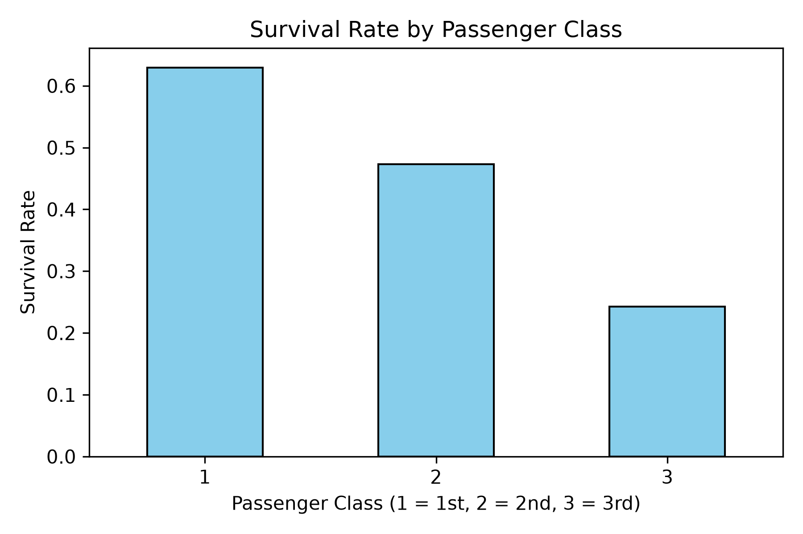
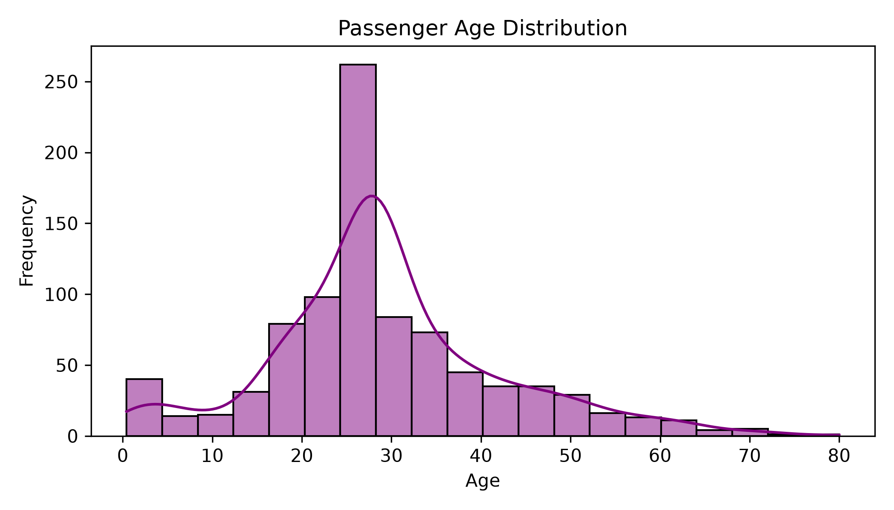
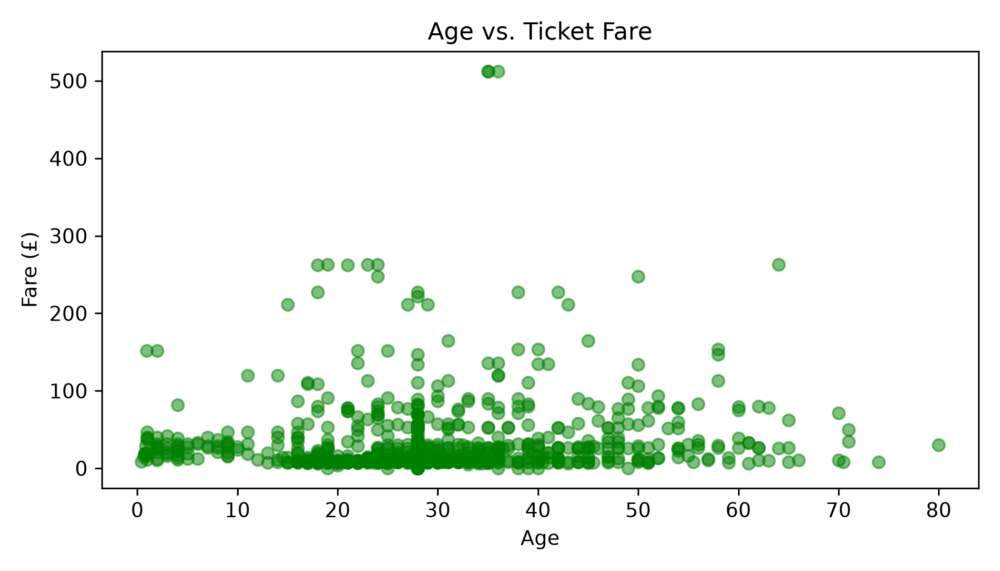

# Titanic Dataset: Exploratory Data Analysis (EDA) Report

## 1. Project Overview
This project performs an end-to-end exploratory data analysis on the classic Titanic passenger dataset to uncover patterns, identify demographic trends, investigate anomalies, and evaluate hypotheses regarding passenger survival.

* **Dataset Dimensions:** 891 rows × 12 columns
* **Target Variable:** `Survived` (0 = Did not survive, 1 = Survived)
* **Key Features:** `Pclass`, `Sex`, `Age`, `SibSp`, `Parch`, `Fare`, `Embarked`

---

## 2. Data Cleaning & Preprocessing
* **Missing Value Imputation:**
  * **`Age`:** 177 missing entries imputed using the column **median** (~28.0 years) to avoid distortion from age extremes.
  * **`Embarked`:** 2 missing records filled using the statistical **mode** (`'S'` - Southampton).
  * **`Cabin`:** Retained for record-keeping but omitted from primary numerical modeling due to high sparsity (~77% null).
* **Deduplication:** Evaluated for duplicate passenger rows via `df.drop_duplicates()`.
* **Subsetting & Filtering:** Isolated passenger cohorts (e.g., First-Class passengers, $n=216$) to evaluate demographic differences across socioeconomic tiers.

---

## 3. Visual Analysis & Statistical Findings

### Insight 1: Socio-Economic Status vs. Survival


* **Finding:** A direct linear relationship exists between passenger class and survival rate.
  * **1st Class:** ~62.96% survived
  * **2nd Class:** ~47.28% survived
  * **3rd Class:** ~24.24% survived
* **Hypothesis Validation:** **Confirmed.** Passengers in higher travel classes experienced significantly higher survival probabilities, consistent with cabin locations closer to boat decks and preferential boarding access during evacuation.

---

### Insight 2: Passenger Age Distribution


* **Finding:** Passenger age distribution exhibits a right-skewed normal curve peaking between **20 and 40 years old**, with the highest density centered around **25–30 years**.
* **Implication:** The majority of individuals aboard were working-age adults traveling for labor, immigration, or personal business.

---

### Insight 3: Age vs. Fare Interactions & Anomalies


* **Finding:** While most fares across all age groups were concentrated under £50, distinct high-fare clusters exist for individuals aged 35–60.
* **Anomalies / Outliers:** Several extreme fare outliers exceed £200, including a subset peaking above £500 (representing luxury multi-cabin suites in first class).
* **Correlation:** A positive correlation exists between fare paid and survival outcome, driven by the protective effect of higher travel class.

---

## 4. Summary & Business Takeaways
1. **Socioeconomic Stratification:** Ticket fare and travel class were primary determinants of survival likelihood.
2. **Demographics:** The passenger base was predominantly young adults, though children and families represented key subsets within 2nd and 3rd class.
3. **Data Quality Considerations:** Median and mode imputation successfully preserved sample size without distorting underlying distribution variances.

---

## 5. How to Run Locally

1. **Clone the repository:**
   ```bash
   git clone [https://github.com/YOUR_GITHUB_USERNAME/titanic_survival_eda.git](https://github.com/YOUR_GITHUB_USERNAME/titanic_survival_eda.git)
   cd titanic_survival_eda